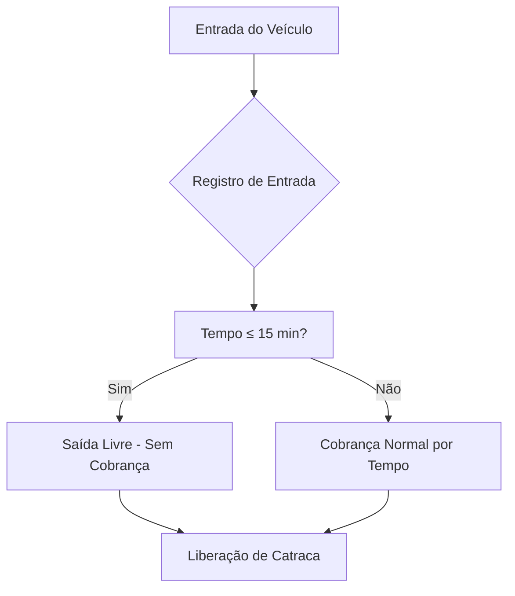
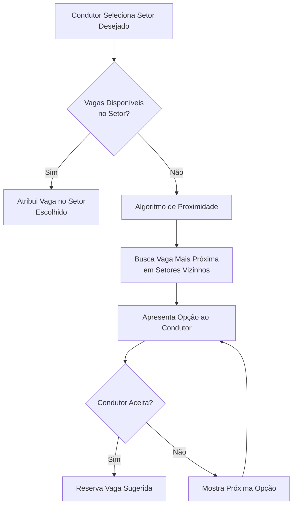
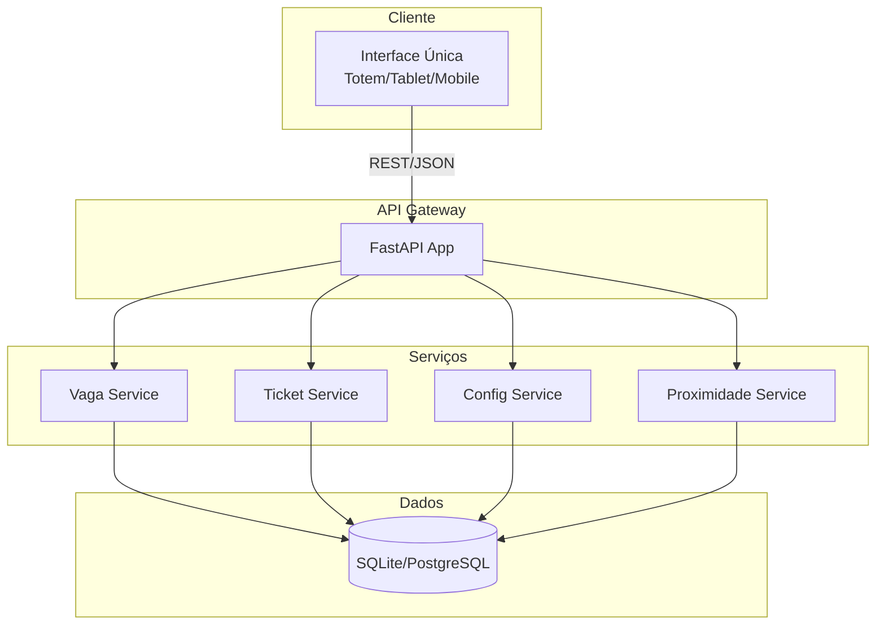

# 🏪 Sistema de Estacionamento Inteligente - Shopping

## 📋 Hackarun | Equipe 44 - Aerodactyle

---

### 👥 Integrantes da Equipe

| Nome | Função |
|------|--------|
| **Guilherme Abreu** | Desenvolvedor Backend / Arquitetura |
| **Álvaro Franco** | Desenvolvedor Fullstack / API |
| **Flávio Antônio** | Desenvolvedor Backend / Banco de Dados |
| **Matheus Dassoler** | Desenvolvedor Frontend / UX & Acessibilidade |

---

## 🎯 1. Visão Geral do Projeto

### Problema
O sistema de estacionamento atual do shopping apresenta diversas lacunas que impactam negativamente a experiência do condutor, especialmente grupos minoritários e proprietários de veículos elétricos.

### Solução Proposta
Desenvolver um **sistema de estacionamento inteligente, acessível e sem burocracia** que opere em uma **única tela**, com interface simples e inclusiva, eliminando a necessidade de login/cadastro e focando na praticidade e qualidade do serviço.

### Princípios Norteadores
- 🚫 **Zero Login** - Entrada direta, sem cadastro
- ♿ **Acessibilidade Total** - Interface usável por todos, independente de capacidades físicas/motoras
- ⚡ **Praticidade** - Fluxo em uma única tela
- 🎯 **Qualidade de Serviço** - Informações em tempo real, vagas inteligentes

---

## 🔍 2. Críticas ao Sistema Atual

| Problema | Impacto | Prioridade |
|----------|---------|------------|
| **Falta de vagas para minorias** (idosos, PCD, neurodivergentes) | Exclusão social, dificuldade de acesso | 🔴 Crítica |
| **Falta de vagas para carros elétricos** | Não atende demanda crescente de EVs | 🔴 Crítica |
| **Sistema não informa disponibilidade de vagas** | Frustração, perda de tempo, congestionamento interno | 🔴 Crítica |
| **Ausência de tolerância para passagem rápida** | Cobrança indevida para quem só passa | 🟡 Alta |
| **Interface complexa / múltiplas telas** | Barreira para usuários com menos familiaridade tecnológica | 🟡 Alta |

---

## ✨ 3. Funcionalidades Propostas

### 3.1 Passagem Rápida (Tolerância de 15 min)


- **Regra**: Primeiros 15 minutos = gratuidade total
- **Após 15 min**: Cobrança proporcional ao tempo de permanência
- **Objetivo**: Permitir "drop-off/pick-up" sem custo

---

### 3.2 Ticket Impresso com Informações
```
┌─────────────────────────────────────┐
│       SHOPPING CENTER - TICKET      │
├─────────────────────────────────────┤
│  Data/Hora Entrada: 13/11/2026 14:30│
│  Vaga: A-12   │   Setor: Azul       │
│  Tipo: Comum  │   Andar: Térreo     │
├─────────────────────────────────────┤
│  Tolerância: 15 min (até 14:45)     │
│  Após: R$ 5,00/hora                 │
├─────────────────────────────────────┤
│  Guarde este ticket para saída      │
└─────────────────────────────────────┘
```

**Informações no ticket**:
- ✅ Data/hora de entrada
- ✅ Número da vaga + Setor (cor/nome)
- ✅ Tipo de vaga (Comum / Idoso / PCD / Neurodivergente / Elétrico)
- ✅ Andar/Bloco
- ✅ Tempo de tolerância e valor hora

---

### 3.3 Vagas Exclusivas para Carros Elétricos
- 🔌 **Já equipadas com carregadores** (Tipo 2 / CCS2)
- 📍 **Localização estratégica**: Próximo a entradas/saídas e elevadores
- ⚡ **Gestão de recarga**: Tempo máximo de ocupação durante carregamento (ex: 2h)
- 📊 **Monitoramento**: Status do carregador (livre/ocupado/manutenção) em tempo real

---

### 3.4 Sistema de Vaga por Proximidade (Smart Parking)



**Algoritmo de Proximidade**:
1. Calcula distância euclidiana/manhattan do setor desejado
2. Prioriza: mesmo andar → andar adjacente → setor mais próximo
3. Considera tipo de vaga compatível (ex: não sugerir vaga PCD para carro comum)
4. Exibe tempo estimado de caminhada até destino

---

### 3.5 Banco de Dados - Vagas e Setores

**Entidades Principais**:
- **Setor** (id, nome, cor, andar, bloco, capacidade_total)
- **Vaga** (id, setor_id, numero, tipo, status, tem_carregador, coordenadas_x, coordenadas_y)
- **Ticket** (id, vaga_id, entrada, saida, valor, status_pagamento)
- **Configuracao** (tolerancia_minutos, valor_hora, tempo_max_recarga_ev)

---

### 3.6 Interface Única - Acessível e Simples

```
┌─────────────────────────────────────────────────────────────┐
│  🅿️  ESTACIONAMENTO INTELIGENTE - SHOPPING                 │
├─────────────────────────────────────────────────────────────┤
│                                                             │
│   🎯  ESCOLHA SEU TIPO DE VAGA:                            │
│   ┌─────┐ ┌─────┐ ┌─────┐ ┌─────┐ ┌─────┐ ┌─────┐         │
│   │COMUM│ │IDOSO│ │ PCD │ │ NEURO│ │ ELÉT│ │ MOTO│         │
│   └─────┘ └─────┘ └─────┘ └─────┘ └─────┘ └─────┘         │
│                                                             │
│   📍  SETOR PREFERENCIAL:  [Azul ▼]  (Opcional)            │
│                                                             │
│   🟢 Vagas Livres: 47/120    🔴 Ocupadas: 73    ⚡ EV: 3/8 │
│                                                             │
│   ┌─────────────────────────────────────────────────────┐  │
│   │  [ GERAR TICKET E ENTRAR ]      [ VER MAPA ]        │  │
│   └─────────────────────────────────────────────────────┘  │
│                                                             │
│   ♿ Alto Contraste  🔊 Leitura de Tela  🌐 Libras          │
└─────────────────────────────────────────────────────────────┘
```

**Características de Acessibilidade**:
- ♿ **WCAG 2.1 AA** - Contraste, navegação por teclado, leitores de tela
- 🔊 **TTS Integrado** - Text-to-speech nativo
- 🌐 **Libras** - Avatar de interpretação (opcional)
- 📱 **Responsivo** - Funciona em totem, tablet, mobile
- 🎨 **Alto Contraste** - Toggle imediato
- ⌨️ **Navegação por Teclado** - Tab order lógico, atalhos

---

## 🛠️ 4. Stack Tecnológica

| Camada | Tecnologia | Justificativa |
|--------|------------|---------------|
| **Backend** | Python 3.11+ (FastAPI) | Performance, tipagem, docs automáticas (Swagger/OpenAPI) |
| **API Testing** | Postman | Coleções compartilháveis, testes automatizados, CI/CD |
| **Banco de Dados** | **SQLite** (dev/protótipo) → **PostgreSQL** (produção) | SQLite: zero config, perfeito para Postman local. PostgreSQL: robustez, concorrência, JSONB |
| **ORM** | SQLAlchemy 2.0 + Alembic | Migrações, async support, type-safe |
| **Validação** | Pydantic v2 | Serialização, validação, docs automáticas |
| **Containerização** | Docker + Docker Compose | Ambiente consistente, deploy simples |
| **Documentação API** | Swagger UI (built-in FastAPI) | Testes interativos no navegador |

### Por que SQLite + Postman?
- ✅ **Zero configuração** - Arquivo único, roda em qualquer lugar
- ✅ **Postman nativo** - `sqlite3` CLI ou extensões permitem inspecionar DB direto
- ✅ **Migração trivial para PostgreSQL** - Mesma sintaxe SQLAlchemy
- ✅ **Ideal para Hackarun** - Protótipo funcional em minutos

---

## 🏗️ 5. Arquitetura do Sistema

### 5.1 Diagrama de Componentes



### 5.2 Modelagem de Dados (ER)

```mermaid
erDiagram
    SETOR ||--o{ VAGA : possui
    VAGA ||--o{ TICKET : gera
    CONFIG ||--o{ SETOR : configura
    
    SETOR {
        int id PK
        string nome
        string cor
        int andar
        string bloco
        int capacidade_total
        datetime created_at
    }
    
    VAGA {
        int id PK
        int setor_id FK
        string numero
        enum tipo {comum, idoso, pcd, neurodivergente, eletrico, moto}
        enum status {livre, ocupada, manutencao, reservada}
        boolean tem_carregador
        int coordenada_x
        int coordenada_y
        datetime created_at
    }
    
    TICKET {
        int id PK
        int vaga_id FK
        datetime entrada
        datetime saida
        decimal valor
        enum status_pagamento {pendente, pago, isento}
        string placa_veiculo
        datetime created_at
    }
    
    CONFIG {
        int id PK
        int tolerancia_minutos DEFAULT 15
        decimal valor_hora DEFAULT 5.00
        int tempo_max_recarga_ev DEFAULT 120
        datetime updated_at
    }
```

### 5.3 Endpoints da API (RESTful)

| Método | Endpoint | Descrição |
|--------|----------|-----------|
| `GET` | `/api/v1/vagas/disponiveis` | Lista vagas livres com filtros (tipo, setor, andar) |
| `GET` | `/api/v1/vagas/proximas` | Busca vaga mais próxima (params: setor_desejado, tipo_vaga) |
| `GET` | `/api/v1/setores` | Lista todos os setores com contagem de vagas livres |
| `POST` | `/api/v1/tickets/entrada` | Registra entrada, atribui vaga, gera ticket |
| `GET` | `/api/v1/tickets/{id}` | Consulta ticket ativo |
| `POST` | `/api/v1/tickets/{id}/saida` | Registra saída, calcula valor, libera vaga |
| `GET` | `/api/v1/config` | Retorna configurações (tolerância, valor hora) |
| `GET` | `/api/v1/health` | Health check para monitoramento |

#### Exemplo: `POST /api/v1/tickets/entrada`

**Request**:
```json
{
  "tipo_vaga": "comum",
  "setor_preferido": "azul",
  "placa_veiculo": "ABC-1234"
}
```

**Response (201)**:
```json
{
  "ticket_id": 42,
  "vaga": {
    "id": 15,
    "numero": "A-12",
    "setor": "Azul",
    "andar": "Térreo",
    "tipo": "comum"
  },
  "entrada": "2026-11-13T14:30:00Z",
  "tolerancia_ate": "2026-11-13T14:45:00Z",
  "valor_hora": 5.00,
  "ticket_impresso": "base64_do_pdf_ou_texto_formatado"
}
```

#### Exemplo: `GET /api/v1/vagas/proximas?setor_desejado=azul&tipo_vaga=comum`

**Response**:
```json
{
  "vaga_sugerida": {
    "id": 23,
    "numero": "B-05",
    "setor": "Verde",
    "andar": "Térreo",
    "distancia_metros": 45,
    "tempo_caminhada_segundos": 60
  },
  "setor_original": "Azul",
  "motivo": "Nenhuma vaga comum livre no setor Azul"
}
```

---

## 📋 6. Requisitos

### 6.1 Requisitos Funcionais (RF)

| ID | Requisito | Prioridade |
|----|-----------|------------|
| RF01 | Sistema deve permitir entrada sem login/cadastro | 🔴 |
| RF02 | Sistema deve registrar entrada e emitir ticket com vaga/setor | 🔴 |
| RF03 | Sistema deve aplicar tolerância de 15 min para passagem rápida | 🔴 |
| RF03 | Sistema deve cobrar proporcional ao tempo após tolerância | 🔴 |
| RF04 | Sistema deve gerenciar vagas por tipo (comum, idoso, PCD, neurodivergente, elétrico, moto) | 🔴 |
| RF05 | Sistema deve indicar vagas elétricas com carregador disponível | 🔴 |
| RF06 | Sistema deve sugerir vaga mais próxima quando setor preferido estiver cheio | 🔴 |
| RF07 | Sistema deve exibir disponibilidade em tempo real por setor/tipo | 🟡 |
| RF08 | Sistema deve permitir consulta de ticket ativo por ID/placa | 🟡 |
| RF09 | Sistema deve calcular valor na saída baseado no tempo real | 🔴 |
| RF10 | Interface deve ser acessível (WCAG 2.1 AA) | 🔴 |

### 6.2 Requisitos Não Funcionais (RNF)

| ID | Requisito | Métrica |
|----|-----------|---------|
| RNF01 | Tempo de resposta API < 200ms (p95) | Performance |
| RNF02 | Disponibilidade 99.5% | Confiabilidade |
| RNF03 | Interface carrega < 3s em 3G | Performance |
| RNF04 | Suporte a 500 requisições simultâneas | Escalabilidade |
| RNF05 | Dados persistidos com ACID | Consistência |
| RNF06 | Logs de auditoria para todas operações | Rastreabilidade |
| RNF07 | Conformidade LGPD (dados mínimos, anonimização) | Legal |
| RNF08 | Deploy em container Docker | Operacional |

---

## 🎭 7. Casos de Uso

### UC01 - Entrada com Vaga Disponível no Setor Desejado
**Ator**: Condutor  
**Pré-condição**: Vagas livres no setor/tipo escolhido  
**Fluxo Principal**:
1. Condutor seleciona tipo de vaga (ex: Comum)
2. Condutor seleciona setor preferido (ex: Azul) - opcional
3. Sistema exibe vagas livres em tempo real
4. Condutor confirma "Gerar Ticket"
5. Sistema atribui vaga, registra entrada, imprime ticket
6. Catraca libera acesso

### UC02 - Entrada com Setor Cheio - Proximidade
**Ator**: Condutor  
**Pré-condição**: Setor desejado sem vagas do tipo selecionado  
**Fluxo Principal**:
1. Condutor seleciona tipo + setor preferido
2. Sistema detecta indisponibilidade
3. Sistema executa algoritmo de proximidade
4. Sistema apresenta vaga alternativa + distância/tempo
5. Condutor aceita ou recusa (mostra próxima opção)
6. Ao aceitar: segue fluxo UC01

### UC03 - Passagem Rápida (≤ 15 min)
**Ator**: Condutor  
**Fluxo Principal**:
1. Condutor entra (ticket gerado)
2. Condutor sai antes de 15 min
3. Sistema calcula tempo = 0
4. Valor = R$ 0,00 (isento)
5. Catraca libera sem pagamento

### UC04 - Estadia Normal (> 15 min)
**Ator**: Condutor  
**Fluxo Principal**:
1. Condutor entra
2. Condutor sai após 15 min
3. Sistema calcula tempo total - 15 min tolerância
4. Valor = horas * valor_hora (arredondado por hora cheia ou fração)
5. Exibe valor, aguarda pagamento (integração futura)
6. Confirma pagamento → libera catraca

### UC05 - Vaga Elétrica com Carregador
**Ator**: Condutor de VE  
**Fluxo Principal**:
1. Condutor seleciona "Elétrico"
2. Sistema mostra apenas vagas com carregador livre
3. Condutor escolhe, gera ticket
4. Sistema monitora tempo de recarga (max 2h configurável)
5. Alerta se exceder tempo (futuro: notificação app/whats)

---

## 📅 8. Cronograma de Entregas - Hackarun

| Sprint | Período | Entregáveis | Responsáveis |
|--------|---------|-------------|--------------|
| **Sprint 0** | Semana 1 | Setup repo, Docker, DB, CI/CD, docs | Todos |
| **Sprint 1** | Semana 2 | CRUD Setores/Vagas, API base, Swagger | Guilherme, Flávio |
| **Sprint 2** | Semana 3 | Lógica de ticket, tolerância, cálculo valor | Álvaro, Flávio |
| **Sprint 3** | Semana 4 | Algoritmo proximidade, tipos de vaga, EV | Guilherme, Matheus |
| **Sprint 4** | Semana 5 | Interface única acessível, ticket impresso | Matheus, Álvaro |
| **Sprint 5** | Semana 6 | Testes Postman, integração, bug fixes, demo | Todos |
| **Entrega Final** | **Fim Semana 6** | **Sistema funcional + Documentação + Apresentação** | **Equipe 44** |

---

## 🧪 9. Estratégia de Testes (Postman)

### Coleções Postman Planejadas

```
📁 Hackarun - Estacionamento Inteligente
├── 📁 01 - Setup & Health
│   ├── GET /health
│   └── GET /config
├── 📁 02 - Setores
│   ├── GET /setores
│   ├── POST /setores (admin)
│   └── GET /setores/{id}/vagas
├── 📁 03 - Vagas
│   ├── GET /vagas/disponiveis?tipo=comum&setor=azul
│   ├── GET /vagas/proximas?setor_desejado=azul&tipo=comum
│   └── GET /vagas/{id}
├── 📁 04 - Tickets - Entrada
│   ├── POST /tickets/entrada (comum, setor azul)
│   ├── POST /tickets/entrada (idoso, sem setor)
│   ├── POST /tickets/entrada (eletrico)
│   └── POST /tickets/entrada (pcd, setor cheio -> proximidade)
├── 📁 05 - Tickets - Saída
│   ├── POST /tickets/{id}/saida (tolerancia - isento)
│   ├── POST /tickets/{id}/saida (normal - cobrado)
│   └── POST /tickets/{id}/saida (ev - tempo recarga)
├── 📁 06 - Cenários de Carga
│   ├── Múltiplas entradas simultâneas
│   └── Stress test proximidade
└── 📁 07 - Testes de Acessibilidade API
    ├── Validação códigos de erro
    └── Tempo de resposta
```

### Critérios de Aceitação Automatizados (Postman Tests)
```javascript
// Exemplo: Teste de tolerância 15 min
pm.test("Passagem rápida ≤ 15 min = valor 0", () => {
    const response = pm.response.json();
    pm.expect(response.valor).to.equal(0);
    pm.expect(response.status_pagamento).to.equal("isento");
});

// Teste de proximidade
pm.test("Vaga sugerida é do tipo correto e mais próxima", () => {
    const vaga = pm.response.json().vaga_sugerida;
    pm.expect(vaga.tipo).to.equal("comum");
    pm.expect(vaga.distancia_metros).to.be.below(100);
});
```

---

## 📁 10. Estrutura do Projeto

```
hackarun-estacionamento/
├── 📁 app/
│   ├── 📁 api/
│   │   ├── 📁 v1/
│   │   │   ├── endpoints/
│   │   │   │   ├── vagas.py
│   │   │   │   ├── tickets.py
│   │   │   │   ├── setores.py
│   │   │   │   └── config.py
│   │   │   └── router.py
│   │   └── deps.py
│   ├── 📁 core/
│   │   ├── config.py
│   │   ├── database.py
│   │   └── security.py (futuro)
│   ├── 📁 models/
│   │   ├── setor.py
│   │   ├── vaga.py
│   │   ├── ticket.py
│   │   └── configuracao.py
│   ├── 📁 schemas/
│   │   ├── vaga.py
│   │   ├── ticket.py
│   │   └── setor.py
│   ├── 📁 services/
│   │   ├── vaga_service.py
│   │   ├── ticket_service.py
│   │   ├── proximidade_service.py
│   │   └── ticket_pdf_service.py
│   └── main.py
├── 📁 tests/
│   ├── test_vagas.py
│   ├── test_tickets.py
│   └── test_proximidade.py
├── 📁 postman/
│   └── Hackarun_Estacionamento.postman_collection.json
├── 📁 alembic/
│   └── versions/
├── 📁 docs/
│   └── ARQUITETURA.md
├── .env.example
├── docker-compose.yml
├── Dockerfile
├── requirements.txt
├── pyproject.toml
└── README.md
```

---

## 🚀 11. Como Executar (Desenvolvimento)

### Pré-requisitos
- Docker 24+ / Docker Compose 2+
- Python 3.11+ (para desenvolvimento local sem Docker)
- Postman (para testes de API)

### Com Docker (Recomendado)
```bash
# Clone e entre no diretório
cd hackarun-estacionamento

# Suba os containers
docker-compose up -d --build

# API disponível em:
# http://localhost:8000
# Swagger UI: http://localhost:8000/docs
# ReDoc: http://localhost:8000/redoc

# Ver logs
docker-compose logs -f api

# Rodar migrações (se necessário)
docker-compose exec api alembic upgrade head

# Popular banco com dados de teste
docker-compose exec api python -m app.scripts.seed_data
```

### Local (Sem Docker)
```bash
# Criar venv
python -m venv .venv
source .venv/bin/activate  # Linux/Mac
# .venv\Scripts\activate   # Windows

# Instalar dependências
pip install -r requirements.txt

# Configurar variáveis
cp .env.example .env
# Editar .env se necessário

# Rodar migrações
alembic upgrade head

# Popular dados
python -m app.scripts.seed_data

# Iniciar servidor
uvicorn app.main:app --reload --host 0.0.0.0 --port 8000
```

### Testes com Postman
1. Importe `postman/Hackarun_Estacionamento.postman_collection.json`
2. Configure environment: `base_url = http://localhost:8000/api/v1`
3. Execute collection: **Run Collection** → veja resultados

---

## 🔮 12. Roadmap Futuro (Pós-Hackarun)

| Fase | Funcionalidade | Valor |
|------|----------------|-------|
| **Fase 2** | Pagamento via PIX/QR Code no ticket | Autonomia total |
| **Fase 2** | App mobile condutor (consulta vaga, histórico) | Fidelização |
| **Fase 2** | Dashboard admin (ocupação, receita, heatmap) | Gestão |
| **Fase 3** | Reconhecimento de placa (OCR câmera entrada) | Zero ticket papel |
| **Fase 3** | Integração com app shopping (promoções, validação) | Ecossistema |
| **Fase 3** | IA preditiva (previsão de ocupação por horário) | Otimização |
| **Fase 4** | Vaga compartilhada (reserva por app) | Nova receita |
| **Fase 4** | Carregamento V2G (vehicle-to-grid) | Sustentabilidade |

---

## 📜 13. Licença e Créditos

```
┌────────────────────────────────────────────────────────────────┐
│  HACKARUN 2026 - EQUIPE 44 - AERODACTYLE                      │
├────────────────────────────────────────────────────────────────┤
│  Guilherme Abreu   │   Álvaro Franco   │   Flávio Antônio     │
│  Matheus Dassoler  │                                        │
├────────────────────────────────────────────────────────────────┤
│  "Tecnologia a serviço da inclusão e mobilidade urbana"       │
└────────────────────────────────────────────────────────────────┘
```

---

**Documento versão**: 1.0  
**Data**: 13/11/2026  
**Status**: 🟢 **Em Desenvolvimento - Sprint 0**

---

*Esta documentação é um artefato vivo e será atualizada a cada sprint.  
Para dúvidas, consulte a equipe Aerodactyle no Hackarun 2026.*
