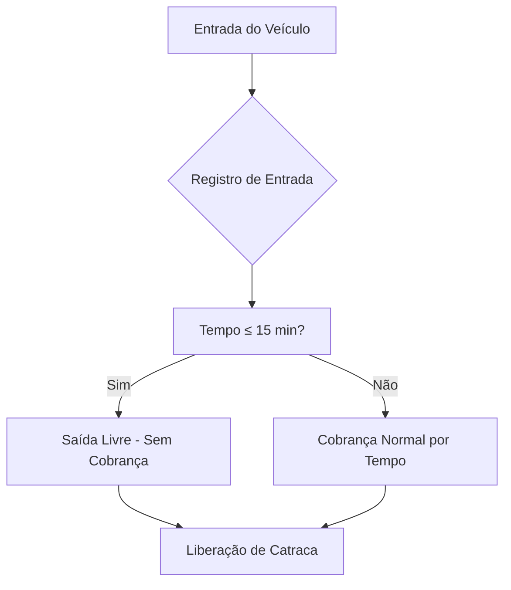
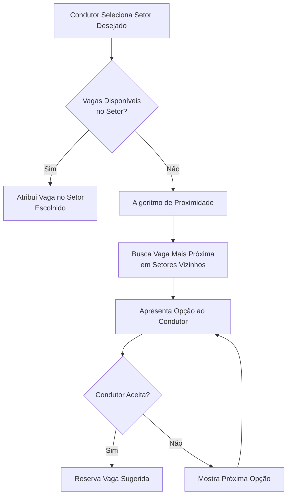

# 🏪 Sistema de Estacionamento Inteligente - Shopping

## 📋 Hackarun 2026 | Equipe 44 - Aerodactyle

---

### 👥 Integrantes da Equipe

- **Guilherme Abreu**
- **Álvaro Franco**
- **Flávio Antônio**
- **Matheus Dassoler**

> *Funções a serem definidas conforme andamento do desenvolvimento*

---

## 🎯 1. Visão Geral do Projeto

### Problema
O sistema de estacionamento atual do shopping apresenta diversas lacunas que impactam negativamente a experiência do condutor, especialmente grupos minoritários e proprietários de veículos elétricos.

### Solução Proposta
Desenvolver um **sistema de estacionamento inteligente, acessível e sem burocracia** que opere em uma **única tela**, com interface simples e inclusiva, eliminando a necessidade de login/cadastro e focando na praticidade e qualidade do serviço.

### Princípios Norteadores
- 🚫 **Zero Login** - Entrada direta, sem cadastro
- ♿ **Acessibilidade Total** - Interface usável por todos, independente de capacidades físicas/motoras
- ⚡ **Praticidade** - Fluxo em uma única tela
- 🎯 **Qualidade de Serviço** - Informações em tempo real, vagas inteligentes

---

## 🔍 2. Críticas ao Sistema Atual

| Problema | Impacto | Prioridade |
|----------|---------|------------|
| **Falta de vagas para minorias** (idosos, PCD, neurodivergentes) | Exclusão social, dificuldade de acesso | 🔴 Crítica |
| **Falta de vagas para carros elétricos** | Não atende demanda crescente de EVs | 🔴 Crítica |
| **Sistema não informa disponibilidade de vagas** | Frustração, perda de tempo, congestionamento interno | 🔴 Crítica |
| **Ausência de tolerância para passagem rápida** | Cobrança indevida para quem só passa | 🟡 Alta |
| **Interface complexa / múltiplas telas** | Barreira para usuários com menos familiaridade tecnológica | 🟡 Alta |

---

## ✨ 3. Funcionalidades Propostas

### 3.1 Passagem Rápida (Tolerância de 15 min)


- **Regra**: Primeiros 15 minutos = gratuidade total
- **Após 15 min**: Cobrança proporcional ao tempo de permanência
- **Objetivo**: Permitir "drop-off/pick-up" sem custo

---

### 3.2 Ticket Impresso com Informações
```
┌─────────────────────────────────────┐
│       SHOPPING CENTER - TICKET      │
├─────────────────────────────────────┤
│  Data/Hora Entrada: 13/11/2026 14:30│
│  Vaga: A-12   │   Setor: Azul       │
│  Tipo: Comum  │   Andar: Térreo     │
├─────────────────────────────────────┤
│  Tolerância: 15 min (até 14:45)     │
│  Após: R$ 5,00/hora                 │
├─────────────────────────────────────┤
│  Guarde este ticket para saída      │
└─────────────────────────────────────┘
```

**Informações no ticket**:
- ✅ Data/hora de entrada
- ✅ Número da vaga + Setor (cor/nome)
- ✅ Tipo de vaga (Comum / Idoso / PCD / Neurodivergente / Elétrico)
- ✅ Andar/Bloco
- ✅ Tempo de tolerância e valor hora

---

### 3.3 Vagas Exclusivas para Carros Elétricos
- 🔌 **Já equipadas com carregadores** (Tipo 2 / CCS2)
- 📍 **Localização estratégica**: Próximo a entradas/saídas e elevadores
- ⚡ **Gestão de recarga**: Tempo máximo de ocupação durante carregamento (ex: 2h)
- 📊 **Monitoramento**: Status do carregador (livre/ocupado/manutenção) em tempo real

---

### 3.4 Sistema de Vaga por Proximidade (Smart Parking)



**Algoritmo de Proximidade**:
1. Calcula distância euclidiana/manhattan do setor desejado
2. Prioriza: mesmo andar → andar adjacente → setor mais próximo
3. Considera tipo de vaga compatível (ex: não sugerir vaga PCD para carro comum)
4. Exibe tempo estimado de caminhada até destino

---

### 3.5 Banco de Dados - Vagas e Setores

**Entidades Principais**:
- **Setor** (id, nome, cor, andar, bloco, capacidade_total)
- **Vaga** (id, setor_id, numero, tipo, status, tem_carregador, coordenadas_x, coordenadas_y)
- **Ticket** (id, vaga_id, entrada, saida, valor, status_pagamento)
- **Configuracao** (tolerancia_minutos, valor_hora, tempo_max_recarga_ev)

---

### 3.6 Interface Única - Acessível e Simples

```
┌─────────────────────────────────────────────────────────────┐
│  🅿️  ESTACIONAMENTO INTELIGENTE - SHOPPING                 │
├─────────────────────────────────────────────────────────────┤
│                                                             │
│   🎯  ESCOLHA SEU TIPO DE VAGA:                            │
│   ┌─────┐ ┌─────┐ ┌─────┐ ┌─────┐ ┌─────┐ ┌─────┐         │
│   │COMUM│ │IDOSO│ │ PCD │ │ NEURO│ │ ELÉT│ │ MOTO│         │
│   └─────┘ └─────┘ └─────┘ └─────┘ └─────┘ └─────┘         │
│                                                             │
│   📍  SETOR PREFERENCIAL:  [Azul ▼]  (Opcional)            │
│                                                             │
│   🟢 Vagas Livres: 47/120    🔴 Ocupadas: 73    ⚡ EV: 3/8 │
│                                                             │
│   ┌─────────────────────────────────────────────────────┐  │
│   │  [ GERAR TICKET E ENTRAR ]      [ VER MAPA ]        │  │
│   └─────────────────────────────────────────────────────┘  │
│                                                             │
│   ♿ Alto Contraste  🔊 Leitura de Tela  🌐 Libras          │
└─────────────────────────────────────────────────────────────┘
```

**Características de Acessibilidade**:
- ♿ **WCAG 2.1 AA** - Contraste, navegação por teclado, leitores de tela
- 🔊 **TTS Integrado** - Text-to-speech nativo
- 🌐 **Libras** - Avatar de interpretação (opcional)
- 📱 **Responsivo** - Funciona em totem, tablet, mobile
- 🎨 **Alto Contraste** - Toggle imediato
- ⌨️ **Navegação por Teclado** - Tab order lógico, atalhos

---

## 🛠️ 4. Stack Tecnológica (Mínima para Hoje)

| Item | Escolha | Por quê |
|------|---------|---------|
| **Linguagem** | Python 3.11+ | Rápido de prototipar, equipe conhece |
| **API** | FastAPI | Docs automáticas (Swagger), validação nativa |
| **Banco** | SQLite | Zero config, arquivo único, roda em qualquer lugar |
| **Testes API** | Postman | Já conhecem, coleções compartilháveis |
| **ORM** | SQLAlchemy (básico) | Simples, sem migrações complexas hoje |

> **Nota**: Sem Docker, sem Alembic, sem PostgreSQL, sem CI/CD — foco no que roda **hoje**.

---

## 🏗️ 5. Arquitetura Mínima (Para Hoje)

### 5.1 Estrutura Simples

```
app/
├── main.py              # FastAPI app + rotas diretas
├── models.py            # SQLAlchemy models (Setor, Vaga, Ticket, Config)
├── schemas.py           # Pydantic schemas (request/response)
├── database.py          # SQLite connection + session
└── services.py          # Lógica de negócio (proximidade, ticket, valor)
```

### 5.2 Modelos Essenciais

| Tabela | Campos Principais |
|--------|-------------------|
| **Setor** | id, nome, cor, andar, capacidade_total |
| **Vaga** | id, setor_id, numero, tipo, status, tem_carregador, x, y |
| **Ticket** | id, vaga_id, entrada, saida, valor, status_pagamento, placa |
| **Config** | id, tolerancia_minutos (15), valor_hora (5.00), tempo_max_recarga_ev (120) |

### 5.3 Endpoints Mínimos (5 no total)

| Método | Endpoint | Descrição |
|--------|----------|-----------|
| `GET` | `/vagas/disponiveis` | Lista vagas livres (filtro: tipo, setor) |
| `GET` | `/vagas/proximas` | Sugere vaga mais próxima se setor cheio |
| `POST` | `/tickets/entrada` | Cria ticket, atribui vaga |
| `POST` | `/tickets/{id}/saida` | Finaliza, calcula valor (com tolerância 15min) |
| `GET` | `/config` | Retorna tolerância e valor/hora |

> **Foco**: 5 endpoints que cobrem 100% do fluxo principal. Swagger em `/docs` para testar.

---

## 📋 6. Requisitos

### 6.1 Requisitos Funcionais (RF)

| ID | Requisito | Prioridade |
|----|-----------|------------|
| RF01 | Sistema deve permitir entrada sem login/cadastro | 🔴 |
| RF02 | Sistema deve registrar entrada e emitir ticket com vaga/setor | 🔴 |
| RF03 | Sistema deve aplicar tolerância de 15 min para passagem rápida | 🔴 |
| RF03 | Sistema deve cobrar proporcional ao tempo após tolerância | 🔴 |
| RF04 | Sistema deve gerenciar vagas por tipo (comum, idoso, PCD, neurodivergente, elétrico, moto) | 🔴 |
| RF05 | Sistema deve indicar vagas elétricas com carregador disponível | 🔴 |
| RF06 | Sistema deve sugerir vaga mais próxima quando setor preferido estiver cheio | 🔴 |
| RF07 | Sistema deve exibir disponibilidade em tempo real por setor/tipo | 🟡 |
| RF08 | Sistema deve permitir consulta de ticket ativo por ID/placa | 🟡 |
| RF09 | Sistema deve calcular valor na saída baseado no tempo real | 🔴 |
| RF10 | Interface deve ser acessível (WCAG 2.1 AA) | 🔴 |

### 6.2 Requisitos Não Funcionais (RNF)

| ID | Requisito | Métrica |
|----|-----------|---------|
| RNF01 | Tempo de resposta API < 200ms (p95) | Performance |
| RNF02 | Disponibilidade 99.5% | Confiabilidade |
| RNF03 | Interface carrega < 3s em 3G | Performance |
| RNF04 | Suporte a 500 requisições simultâneas | Escalabilidade |
| RNF05 | Dados persistidos com ACID | Consistência |
| RNF06 | Logs de auditoria para todas operações | Rastreabilidade |
| RNF07 | Conformidade LGPD (dados mínimos, anonimização) | Legal |
| RNF08 | Deploy em container Docker | Operacional |

---

## 🎭 7. Casos de Uso

### UC01 - Entrada com Vaga Disponível no Setor Desejado
**Ator**: Condutor  
**Pré-condição**: Vagas livres no setor/tipo escolhido  
**Fluxo Principal**:
1. Condutor seleciona tipo de vaga (ex: Comum)
2. Condutor seleciona setor preferido (ex: Azul) - opcional
3. Sistema exibe vagas livres em tempo real
4. Condutor confirma "Gerar Ticket"
5. Sistema atribui vaga, registra entrada, imprime ticket
6. Catraca libera acesso

### UC02 - Entrada com Setor Cheio - Proximidade
**Ator**: Condutor  
**Pré-condição**: Setor desejado sem vagas do tipo selecionado  
**Fluxo Principal**:
1. Condutor seleciona tipo + setor preferido
2. Sistema detecta indisponibilidade
3. Sistema executa algoritmo de proximidade
4. Sistema apresenta vaga alternativa + distância/tempo
5. Condutor aceita ou recusa (mostra próxima opção)
6. Ao aceitar: segue fluxo UC01

### UC03 - Passagem Rápida (≤ 15 min)
**Ator**: Condutor  
**Fluxo Principal**:
1. Condutor entra (ticket gerado)
2. Condutor sai antes de 15 min
3. Sistema calcula tempo = 0
4. Valor = R$ 0,00 (isento)
5. Catraca libera sem pagamento

### UC04 - Estadia Normal (> 15 min)
**Ator**: Condutor  
**Fluxo Principal**:
1. Condutor entra
2. Condutor sai após 15 min
3. Sistema calcula tempo total - 15 min tolerância
4. Valor = horas * valor_hora (arredondado por hora cheia ou fração)
5. Exibe valor, aguarda pagamento (integração futura)
6. Confirma pagamento → libera catraca

### UC05 - Vaga Elétrica com Carregador
**Ator**: Condutor de VE  
**Fluxo Principal**:
1. Condutor seleciona "Elétrico"
2. Sistema mostra apenas vagas com carregador livre
3. Condutor escolhe, gera ticket
4. Sistema monitora tempo de recarga (max 2h configurável)
5. Alerta se exceder tempo (futuro: notificação app/whats)

---

## 📅 8. Cronograma — **Hoje Até Meio-Dia**

| Horário | Foco | Entregável |
|---------|------|------------|
| **Agora → 09:00** | Setup + Models + DB | SQLite rodando, tabelas criadas |
| **09:00 → 10:30** | Endpoints core (5) | API funcional no `/docs` |
| **10:30 → 11:30** | Lógica: tolerância 15min + proximidade | Regras de negócio OK |
| **11:30 → 12:00** | Testes Postman + coleção | Collection pronta para demo |

> **Meta**: API rodando, testada no Postman, pronta para apresentar ao meio-dia.

---

## 🧪 9. Estratégia de Testes (Postman)

### Coleções Postman Planejadas

```
📁 Hackarun - Estacionamento Inteligente
├── 📁 01 - Setup & Health
│   ├── GET /health
│   └── GET /config
├── 📁 02 - Setores
│   ├── GET /setores
│   ├── POST /setores (admin)
│   └── GET /setores/{id}/vagas
├── 📁 03 - Vagas
│   ├── GET /vagas/disponiveis?tipo=comum&setor=azul
│   ├── GET /vagas/proximas?setor_desejado=azul&tipo=comum
│   └── GET /vagas/{id}
├── 📁 04 - Tickets - Entrada
│   ├── POST /tickets/entrada (comum, setor azul)
│   ├── POST /tickets/entrada (idoso, sem setor)
│   ├── POST /tickets/entrada (eletrico)
│   └── POST /tickets/entrada (pcd, setor cheio -> proximidade)
├── 📁 05 - Tickets - Saída
│   ├── POST /tickets/{id}/saida (tolerancia - isento)
│   ├── POST /tickets/{id}/saida (normal - cobrado)
│   └── POST /tickets/{id}/saida (ev - tempo recarga)
├── 📁 06 - Cenários de Carga
│   ├── Múltiplas entradas simultâneas
│   └── Stress test proximidade
└── 📁 07 - Testes de Acessibilidade API
    ├── Validação códigos de erro
    └── Tempo de resposta
```

### Critérios de Aceitação Automatizados (Postman Tests)
```javascript
// Exemplo: Teste de tolerância 15 min
pm.test("Passagem rápida ≤ 15 min = valor 0", () => {
    const response = pm.response.json();
    pm.expect(response.valor).to.equal(0);
    pm.expect(response.status_pagamento).to.equal("isento");
});

// Teste de proximidade
pm.test("Vaga sugerida é do tipo correto e mais próxima", () => {
    const vaga = pm.response.json().vaga_sugerida;
    pm.expect(vaga.tipo).to.equal("comum");
    pm.expect(vaga.distancia_metros).to.be.below(100);
});
```

---

## 📁 10. Estrutura do Projeto (Mínima)

```
hackarun-estacionamento/
├── app/
│   ├── main.py           # FastAPI + 5 rotas
│   ├── models.py         # 4 models SQLAlchemy
│   ├── schemas.py        # Pydantic request/response
│   ├── database.py       # Engine + session SQLite
│   └── services.py       # Lógica: proximidade, ticket, valor
├── postman/
│   └── collection.json   # Coleção de testes
├── requirements.txt      # fastapi, uvicorn, sqlalchemy, pydantic
└── README.md
```

> **Não tem**: Docker, Alembic, testes automatizados, pasta docs/, pyproject.toml, .env — **não dá tempo hoje**.

---

## 🚀 11. Como Executar (Hoje — Sem Docker)

```bash
# 1. Criar venv e instalar
python -m venv .venv
source .venv/bin/activate
pip install fastapi uvicorn sqlalchemy pydantic

# 2. Rodar (cria DB automaticamente)
uvicorn app.main:app --reload --port 8000

# 3. Testar
# Swagger: http://localhost:8000/docs
# Postman: importar postman/collection.json, base_url = http://localhost:8000
```

> **Pronto em < 2 min**. Sem Docker, sem migrações, sem seed script — o `main.py` cria as tabelas e popula dados mínimos no startup.

---

## 📜 Créditos

**HACKARUN 2026 — EQUIPE 44 — AERODACTYLE**  
Guilherme Abreu · Álvaro Franco · Flávio Antônio · Matheus Dassoler  

> "Tecnologia a serviço da inclusão e mobilidade urbana"

---

**Documento versão**: 1.0  
**Data**: 13/11/2026  
**Status**: 🟡 **Desenvolvimento — Entrega hoje ao meio-dia**

---

*Doc enxuto para o que dá tempo de fazer hoje. Atualizações conforme avancemos.*
